# Cuphead - WinAPI 개인 프로젝트

> C++과 Win32 API로 Cuphead의 플레이어 액션, 보스 전투, 런 앤 건과 월드·상점·인벤토리를 구현한 개인 프로젝트입니다.

<!-- 초안: GIF는 파일명 기준으로 배치했습니다. 장면별 제목과 설명은 함께 확인하며 채웁니다. -->

## 개요

**Cuphead 모작 · 개인 프로젝트** 
**개발 기간:** 2025.10.27 ~ 2025.11.07 (약 2주) 
**개발 환경:** C++ · Win32 API · GDI · FMOD · Visual Studio 2022 
**URL:** 추후 추가

## 하이라이트

<table>
  <tr>
    <td width="50%" align="center">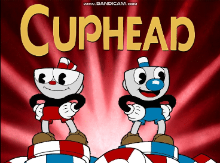 <b>오프닝</b></td>
    <td width="50%" align="center">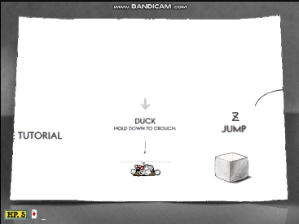 <b>플레이어 액션</b></td>
  </tr>
  <tr>
    <td width="50%" align="center">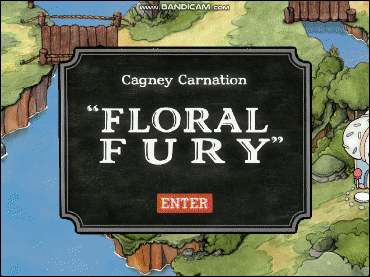 <b>보스 전투</b></td>
    <td width="50%" align="center"> <b>런 앤 건</b></td>
  </tr>
</table>

<!-- 전체 시연 영상 링크는 준비 후 이곳에도 배치합니다. -->

## 구현 범위

| 분야 | 핵심 내용 |
| --- | --- |
| 플레이어 액션 | 점프·낙하 상태 분리, 공중 패링과 반동 상승, 이동·사격·대시 및 상태별 애니메이션 |
| 월드 · 씬 간 데이터 | 월드 플레이어의 방향·상태별 이미지 전환, 씬 이동 시 월드 위치·카메라 복원, 코인·소유 아이템·장착 정보 유지 |
| 상점 · 인벤토리 | 보유 코인에 따른 구매 검사와 차감, 구매 아이템 관리, 인벤토리에서 장비 변경 및 전투 플레이어에 적용 |
| 보스 | 체력에 따른 페이즈 전환, 공격 패턴별 상태 처리, 애니메이션 진행에 맞춘 투사체 생성 |
| 런 앤 건 | 라인·타일 데이터를 이용한 지형 구성, 적·발판·트램펄린 배치와 충돌 처리, 클리어·사망 후 월드 복귀 |

## 주요 구현

[1. 플레이어 액션](#1-플레이어-액션) · [2. 월드와 씬 간 데이터](#2-월드와-씬-간-데이터) · [3. 상점과 인벤토리](#3-상점과-인벤토리) · [4. 보스](#4-보스) · [5. 런 앤 건](#5-런-앤-건)

### 1. 플레이어 액션

점프·낙하·패링을 구분하고, 각 상태에서 이동과 공격이 이어지도록 구성했습니다. 상태가 바뀔 때 애니메이션을 설정하는 처리와 상태별 행동을 수행하는 처리를 나누었습니다.

<table>
  <tr>
    <td width="50%" align="center"> 플레이어 조작_01 · 점프, 대쉬, 낙하</td>
    <td width="50%" align="center">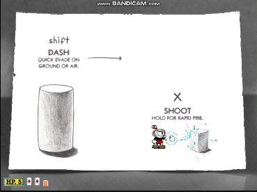 플레이어 조작_02 · 공격, 패링</td>
  </tr>
  <tr>
    <td colspan="2" align="center">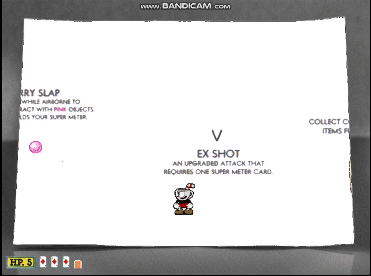 플레이어 조작_03 · 필살기, 코인 충돌</td>
  </tr>
</table>

#### 점프와 낙하 상태 분리

`JUMP`에서는 점프 변위를 계산하고, 계산된 변위가 음수가 되면 `FALL`로 전환하면서 점프 시간을 초기화하고 중력을 활성화합니다. 착지할 지형의 높이는 라인 데이터를 통해 확인하며, 착지 시 낙하·패링 상태에서 대기 상태로 돌아갑니다.

점프와 낙하는 같은 스프라이트 모션을 사용하지만 논리 상태는 분리했습니다. 따라서 이미지와 별개로 상승·낙하 여부를 판단하고 공중 행동과 착지 조건을 처리합니다.

#### 패링

공중에서 점프 키를 다시 누르면 `PARRY` 상태로 전환하고 입력 시각을 기록합니다. 이 시각을 기준으로 **100ms 동안 패링 판정**을 활성화하며, 해당 구간에 패링 대상과 충돌하면 중력과 점프 시간을 재설정해 다시 상승합니다.

패링 투사체와 패링 오브젝트의 충돌 분기를 구분했습니다. 오브젝트에는 입력당 성공 여부를 확인하는 플래그를 두고, 투사체 패링에 성공하면 데이터 매니저의 패링 횟수를 증가시킵니다. 성공 시 효과음과 이펙트도 함께 재생합니다.

<b>세부 구현과 관련 코드</b>

- [`CPlayer::Switch_State`](CodeSamples/Private/CPlayer.cpp#L538): 상태 변경 시 애니메이션의 프레임 범위·모션·재생 간격 설정.
- [`CPlayer::Switch_Motion`](CodeSamples/Private/CPlayer.cpp#L672): 점프·대시·패링·피격 등 상태별 행동과 전환 조건 처리.
- [`CPlayer::OnCollision`의 패링 처리](CodeSamples/Private/CPlayer.cpp#L1032): 충돌 대상과 판정 활성화 여부에 따른 반동 상승 처리.

### 2. 월드와 씬 간 데이터

월드용 `CWorldPlayer`와 전투용 `CPlayer`를 분리하고, 씬을 넘어 유지할 정보는 `CDataMgr`에서 관리합니다. 월드 위치·카메라, 코인, 소유 아이템, 장착 정보를 씬 오브젝트의 수명과 분리한 구조입니다.

<table>
  <tr>
    <td width="50%" align="center">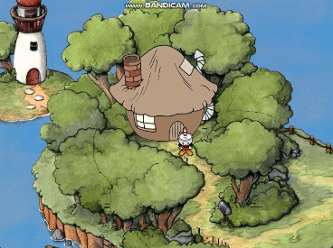 월드맵_01</td>
    <td width="50%" align="center">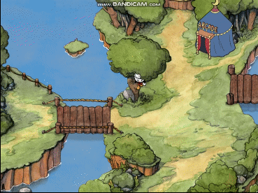 월드맵_02</td>
  </tr>
</table>

#### 씬 전환 시 데이터 유지

월드 씬의 `Release()`에서 플레이어 위치와 카메라 좌표를 데이터 매니저에 기록한 뒤 씬의 매니저들을 정리합니다. 월드로 돌아오면 플레이어 초기화 시 위치를, 월드 씬 초기화 시 스크롤을 읽어 이전 지점으로 복원합니다.
코인과 아이템도 데이터 매니저에 보관하므로 씬을 이동한 뒤 사용할 수 있습니다.

<b>세부 구현과 관련 코드</b>

- [`CWorld::Release`](CodeSamples/Private/CWorld.cpp#L109): 월드 위치·카메라 보관 후 씬 정리.
- [`CWorld::Initialize`](CodeSamples/Private/CWorld.cpp#L37), [`CWorldPlayer::Initialize`](CodeSamples/Private/CWorldPlayer.cpp#L16): 월드 재진입 시 데이터 복원.
- [`CDataMgr`](CodeSamples/Public/CDataMgr.h): 씬 사이에서 유지할 데이터와 접근 함수 정의.

### 3. 상점과 인벤토리

**코인 획득 → 상점 구매 → 소유 목록 갱신 → 무기 장착 → 전투 플레이어 초기화 시 적용**으로 연결했습니다. 소유한 아이템과 현재 장착한 무기를 별도로 관리합니다.

<table>
  <tr>
    <td width="50%" align="center">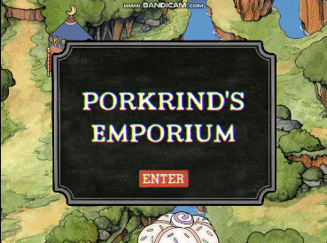 상점</td>
    <td width="50%" align="center">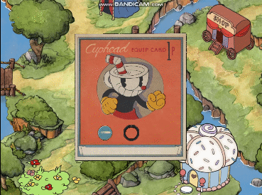 인벤토리</td>
  </tr>
</table>

#### 구매 처리

`CCoin`이 플레이어와 충돌하면 보유 코인을 증가시킵니다. 상점에서 구매를 확정하면 아이템 가격과 보유 코인을 비교하고, 구매 가능한 경우 코인을 차감한 뒤 아이템을 복제해 소유 목록에 추가합니다. 이후 상점의 해당 항목을 제거합니다.

상점에 진입할 때는 데이터 매니저의 상품 목록을 복제해서 사용하고, 나갈 때 남은 상품 목록을 다시 보관합니다. 이를 통해 구매한 상품이 상점 재진입 시 다시 나타나지 않도록 구성했습니다.

#### 장착

장착 화면에서 변경할 무기 슬롯을 선택하면 인벤토리를 열고, 선택한 아이템의 타입을 데이터 매니저에 전달합니다. 장착 변경 로직에는 동일 무기의 중복 장착을 정리하고 두 슬롯이 모두 비지 않도록 확인하는 처리가 들어 있습니다.

<b>세부 구현과 관련 코드</b>

- [`CStore::Key_Input`](CodeSamples/Private/CStore.cpp#L143): 구매 조건 검사, 코인 차감, 소유 목록 추가와 상품 제거.
- [`CEquipItem::Key_Input`](CodeSamples/Private/CEquipItem.cpp#L73), [`CInven::Key_Input`](CodeSamples/Private/CInven.cpp#L118): 장착 슬롯과 아이템 선택.
- [`CDataMgr::Set_CurPlayerItem`](CodeSamples/Private/CDataMgr.cpp#L50): 장착 타입 변경과 중복·빈 슬롯 처리.

### 4. 보스

꽃 보스 `CFlower`는 등장, 대기, 공격, 페이즈 전환 상태로 전투를 진행합니다. 공격 선택과 종료 조건을 처리하는 상태 로직에 애니메이션과 투사체 생성 타이밍을 연결했습니다.

<table>
  <tr>
    <td width="50%" align="center"> 보스_01 진입</td>
    <td width="50%" align="center">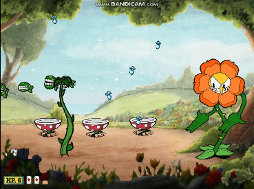 보스_02 패턴1,2</td>
  </tr>
  <tr>
    <td width="50%" align="center">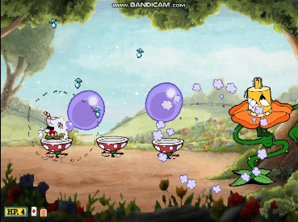 보스_03 페이즈 변환</td>
    <td width="50%" align="center">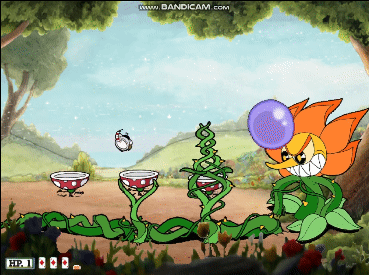 보스_04 패턴3,4</td>
  </tr>
</table>

#### 패턴과 페이즈 전환

초기 체력은 120이며, 체력이 50 이하가 되면 2페이즈 전환 상태로 진입합니다. 페이즈 전환 플래그를 두어 전환 처리가 반복되지 않도록 했습니다.

1페이즈에서는 부메랑과 낙하 투사체 패턴을, 2페이즈에서는 발판 위치의 덩굴과 꽃잎 투사체 패턴을 사용합니다. 대기 시간 후 패턴을 선택하고, 애니메이션 종료 여부·경과 시간·생성 횟수를 확인해 다음 상태로 넘어갑니다.

#### 애니메이션과 공격 타이밍

꽃잎 공격은 애니메이션의 13번 프레임에서 투사체를 생성하고, 생성 카운터를 확인해 같은 공격에서 중복 생성되지 않도록 합니다.

상태 변경 시 애니메이션 정보를 설정하고, 프레임 진행 중 종료 플래그를 갱신합니다. 패턴마다 프레임 조건과 시간 조건을 사용해 준비 동작, 공격, 종료 동작을 연결했습니다.

<b>클리어 장면</b>

  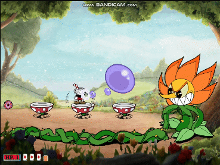

<b>세부 구현과 관련 코드</b>

- [`CFlower::Update`](CodeSamples/Private/CFlower.cpp#L71): 체력에 따른 페이즈 전환.
- [`CFlower::Create_Rain`](CodeSamples/Private/CFlower.cpp#L503): 시간 간격을 둔 투사체 생성.
- [`CFlower::Create_Petal`](CodeSamples/Private/CFlower.cpp#L552): 특정 애니메이션 프레임과 생성 카운터를 이용한 공격.
- [`CFlower::Move_Frame`](CodeSamples/Private/CFlower.cpp#L561): 프레임 갱신과 애니메이션 종료 판정.

### 5. 런 앤 건

횡스크롤 구간에 적, 장애물, 트램펄린과 발판을 배치했습니다. 씬 클래스에서 스테이지를 구성하고 충돌 검사 대상을 연결하며, 플레이어 클래스에서 충돌 이후의 행동을 처리합니다.

<table>
  <tr>
    <td width="50%" align="center"> 런 앤 건_01_</td>
    <td width="50%" align="center"> 런 앤 건_02</td>
  </tr>
  <tr>
    <td colspan="2" align="center"> 런 앤 건_03</td>
  </tr>
</table>

#### 스테이지 구성과 기믹

초기화 시 `RNGLine.dat`과 `RNGTile.dat`을 불러오고, 적과 기믹 오브젝트를 지정된 좌표에 생성합니다. 지형 데이터와 오브젝트 배치를 구분하며, 플레이어의 횡스크롤을 활성화하고 스테이지 범위 안으로 카메라를 제한합니다.

#### 스테이지 진행과 종료

월드의 런 앤 건 트리거에서 진입 입력을 받으면 화면 닫힘 연출 후 스테이지로 이동합니다. 스테이지 시작 시 준비 연출과 효과음을 재생합니다.

플레이어가 목표 좌표에 도달하면 클리어 연출을 실행하고, 사망하면 종료 대기를 시작합니다. 두 경우 모두 3초 후 화면 닫힘 연출을 거쳐 월드로 돌아갑니다. 종료 플래그로 연출과 종료 시각 설정이 반복되지 않도록 합니다.

<b>세부 구현과 관련 코드</b>

- [`CRNGTrigger`](CodeSamples/Private/CRNGTrigger.cpp): 월드의 진입 안내와 씬 전환.
- [`CRunAndGun::Initialize`](CodeSamples/Private/CRunAndGun.cpp#L34): 지형 로드와 오브젝트 배치.
- [`CRunAndGun::Late_Update`](CodeSamples/Private/CRunAndGun.cpp#L154): 대상 조합별 충돌 검사 호출.
- [`CRunAndGun::Update`](CodeSamples/Private/CRunAndGun.cpp#L101): 시작 연출, 클리어·사망 감지와 월드 복귀.

## 기술 스택

| 기술 | 프로젝트에서의 활용 |
| --- | --- |
| C++ | 게임 오브젝트·씬 클래스와 상태별 행동, 데이터 관리 |
| Win32 API · GDI | 비트맵 출력, 투명색 기반 스프라이트 렌더링, 입력·시간 처리 |
| FMOD | 배경음악과 플레이어·보스·씬 효과음 재생 |
| Visual Studio | C++ 프로젝트 개발 환경 |

## 제작 목적 및 리소스 출처

본 프로젝트는 게임 클라이언트 개발 학습을 위해 제작한 **비영리 교육용 모작**입니다. 원작 리소스는 학습·교육 목적으로만 사용했으며, 구현 내용과 학습 결과를 포트폴리오로 정리했습니다.

원작은 **Studio MDHR의 Cuphead**이며, 사용된 원작 이미지·음원 등 리소스의 권리는 각 권리자에게 있습니다. 본 프로젝트는 원작의 공식 프로젝트가 아닙니다.
